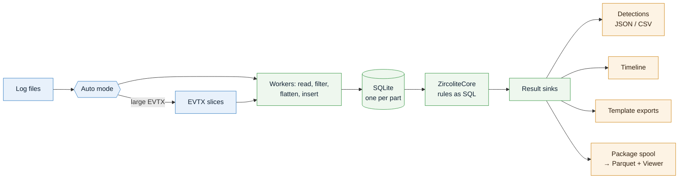
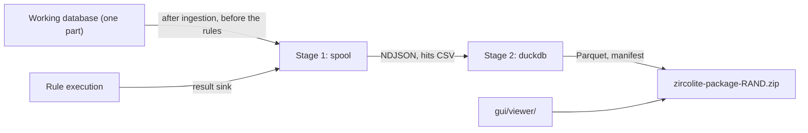

# Internals

Zircolite flattens events into SQLite and runs Sigma rules converted to SQL against them.
This page covers how, and the behaviour the command line does not make obvious. For how to
*use* any of it, see [Usage](Usage.md) and [Advanced](Advanced.md).

## Architecture



A **part** is one working database: a file, an EVTX slice, or every file in a unified
run. Reading, flattening and insertion happen in one pass. The only intermediate files are
7-Zip members, which are spooled to disk.

## Event processing pipeline

| Stage | What it does | Example |
|-------|--------------|---------|
| **1. Filter** | Skip events whose Channel, or that channel's EventID set, no rule claims | Channel/EventID check |
| **2. Flatten** | Nested → flat structure | `Event.System.Channel` → `Channel` |
| **3. Mappings** | Rename fields | `Event.EventData.CommandLine` → `CommandLine` |
| **4. Aliases** | Copy a field under a new name | `CommandLine` → `cmdline` |
| **5. Transforms** | Sandboxed Python over the value | Extract the filename from a path |
| **6. Splits** | Parse key=value strings | `"a=1,b=2"` → `{a:1, b:2}` |

Transforms run before splitting, so a transform that *replaces* a value changes what the
split parses. Split fields are written directly (aliases do not apply to them), cleaned like
any field name, and merged only where the event has no field of that name in any case, so
log content cannot overwrite a real field or `row_id`.

**Typing.** Columns are added as fields appear. Events are inserted in batches of 250, one
statement per run of events that share their fields, so a row binds only its own fields
rather than its whole batch's mostly NULL union. A batch that holds two spellings of one
field, or a stray `rowid`/`oid`/`_rowid_` key, falls back to one statement over the union.
`row_id` is a plain `INTEGER PRIMARY KEY`. A column takes its type from the first value it
receives: `INTEGER`, `NUMERIC` for floats (so ranges compare numerically), or `TEXT`.
Integers beyond SQLite's signed 64-bit range are stored as floats and may be rounded; the
run warns once and names the fields.

Every table also declares `rowid` and `oid` as `TEXT`. SQLite reads those bare names as the
row ID unless a column declares them, and since 3.54 ALTER TABLE cannot add such a column. A
field of either name (`row_id` becomes `rowid` once cleaned) is therefore stored as text, and
a rule naming one reads that field, NULL for an event without it. Detections and CSV headers
leave the columns out unless an event filled them; a database saved with `--dbfile` keeps
them. A correlation plan that identifies events by `rowid`, the backend's default, is
refused; Zircolite converts rules with `row_id`.

**Spellings.** SQLite column names are case-insensitive, so `ProcessId` and `ProcessID`
share one column, named after the first spelling stored. Ingestion records every event that
spelled a field otherwise (tables `field_spellings` and `logs_spelling`), and output prints
each event with its own spelling, so per-file, unified and parallel runs print an event the
same way. The time field is the exception: it always prints under its `--timefield` name,
which the Timesketch template and the Viewer look up. Rule SQL never reads those tables.

**Readers.** JSON arrays are validated incrementally, accelerated by `ijson` when present.
ZIP members stream from the archive; 7-Zip members spool to temporary files. CSV raises the
field-size limit to the platform's maximum. XML and EVTXtract readers skip comments and
processing instructions between records.

When a rule has several SQL statements, an event matched by more than one is kept once, by
`row_id`, before `--limit` applies.

### Event filter bounds

The [early event filter](Advanced.md#early-event-filtering) maps each channel the ruleset
names to the EventIDs its rules can match. Those IDs are read from each rule's **SQL**, not
its `eventid` metadata, which collects values from every detection group, negated filters
included:

```yaml
detection:
    selection:
        Channel: Security
    filter:
        EventID: 4624
    condition: selection and not filter
```

That rule's metadata says `eventid: [4624]`, the one ID it excludes. A channel stays
unbounded (every EventID kept) when a rule on it constrains `EventID` under a `NOT`, has an
`OR` branch without an `EventID` constraint, constrains it in a form the scan cannot read
(`BETWEEN`, `>`, `LIKE`), or does not mention it. Any other expression, such as a `CASE`
or the backend's numeric and `|week` tests, constrains nothing itself: the conditions
`AND`ed with it still bound the rule, and nothing inside it is read. A rule constraining
EventIDs but no channel switches the filter to two global axes, each filtering only when
every rule constrains it. Any correlation turns the filter off for the run: a backend-2 plan, or a
legacy (backend 1) correlation with no channel in its SQL.

The filter reads its values from the raw event, before flattening, through the compiled
kernel (`event_filter_values`, about 0.8 µs an event). An event carrying several of the
configured fields with different values is kept, since the flattener decides which value
lands in the column.

## Rule execution

**Ruleset input.** JSON rulesets are decoded once. pySigma is imported only for native
conversion or an explicit pipeline. Sigma YAML is parsed once with the safe C loader (the
Python one without LibYAML) and passed to `SigmaCollection.from_dicts`, so every file
merges before filters and cross-file references resolve.

**Analysis cache.** Normalising, scanning and planning the prefilter for each statement
share one lexing pass. The command line keeps the results in the user's cache directory
(`~/Library/Caches/Zircolite`, `%LOCALAPPDATA%\Zircolite\Cache` or
`$XDG_CACHE_HOME/zircolite`):
- one file per selection of statements, keyed by the statements, the Python version and a
  hash of the analysing code (in a binary, the executable), with a SHA-256 checksum;
- the eight newest files are kept, and a new selection reuses their statements and
  analyses only the rest;
- process workers find the directory through `ZIRCOLITE_ANALYSIS_CACHE`, which the parent
  sets.

[Usage → Performance](Usage.md#performance) lists the variables that move or disable it.
Library callers never write one.

**Census pruning.** Before the rules run, `execute_ruleset` reads the distinct
`(Channel, EventID)` pairs present, through `idx_channel_eventid`. A rule is skipped when
every statement is a plain `SELECT * FROM logs WHERE …` whose `sqlscan` bounds (the same
the event filter uses) miss all of them. Statements without bounds, correlations, aggregate
projections, columns holding values SQLite would coerce, and tables with unusual
collations always run. A skipped rule saves its statement preparation, on every file.

**Correlation plans.** A rule with a `correlation_plan` (SQLite backend 2) never runs its
`rule` SQL. `core.py` hands the plan to the backend's `runtime.execute_plan`, which widens
`logs` with the plan's `required_fields`, materialises each stage as an indexed TEMP table,
runs the result and diagnostic queries, fetches the evidence by `row_id` and drops the
tables. A progress handler checks for Ctrl+C every 10,000 SQLite instructions. Plans are
never repaired, scanned, prefiltered or used to pick indexes. A plan this install cannot run
(version, SQLite) is reported at load and recorded as a rule error.

**Literal prefilter.** Most rules match with `LIKE` patterns. The prefilter reads the fields
those patterns name once, finds which events contain each pattern's necessary literal
(Aho–Corasick search, row IDs in Roaring bitmaps), and runs each query only over those
candidate events. SQLite still evaluates the whole condition on every candidate, so
detections are identical with the filter on or off.


- `auto` builds it for databases of 1,000 events or more and rulesets with 32 or more
  eligible queries; `literal` forces it, `off` disables it.
- Only plain `SELECT * FROM logs WHERE …` statements qualify. A pattern contributes its
  longest literal run of three characters or more, or one holding a non-ASCII character.
  AND intersects candidates, OR unions them, NOT gives no bound.
- A literal `REGEXP` pattern contributes the longest literal run every match must contain.
  The scanner knows escapes, classes, groups, quantifiers and top-level alternation, and
  gives up on anything else (`\p{…}`, POSIX classes, verbose mode, flags other than `i`,
  `m`, `s`). Under `(?i)`, runs break at `i`, `k`, `s` and non-ASCII characters, which the
  `regex` module also matches to other cased letters (U+0130, U+212A, U+017F, …).
- Positive string equality contributes its value on columns with TEXT affinity and
  BINARY/NOCASE collation, checked per database, so `LIKE … OR field='…'` can be bounded
  whole.
- Before planning, the fields that census-admitted backend rules declare but the data
  lacks are added as NULL columns, all at once or not at all, and only past the `auto`
  thresholds. CSV output, correlations, legacy rules without field metadata, and fields
  named `_rowid_`, `true` or `false` keep the per-rule [repair](#automatic-sql-repairs)
  instead.
- Candidates reach SQLite as `logs.row_id IN (SELECT value FROM json_each('[...]'))` ahead
  of the original predicate. A rule with no candidates runs `SELECT 1 WHERE 0`. A candidate
  set holding at least half the rows the rule's bounds select is bypassed.
- Construction is capped (one million pattern characters; sixteen row IDs per event, and
  never fewer than two million); a column over budget becomes unbounded. It needs SQLite's
  JSON1, and stays off without it.
- Each field automaton caches up to 512 recent values of at most 1,024 characters, within
  an 8 MiB budget shared by the indexed fields, for one index build only.

## Processing modes

[Advanced → Automatic processing optimization](Advanced.md#automatic-processing-optimization)
describes the two layouts and how auto mode picks one. `analyze_files_and_recommend_mode`
returns only `per-file` or `unified`, and for a per-file run of several inputs it separately
recommends workers, one database each. That is why parallelism exists only for per-file
runs. `--strict` and `--profile-rules` turn parallelism off, because a parse error and a
per-rule timing both need one file at a time.

**Executors.** Threads share one GIL, which every SQLite row step releases and takes back,
so thread workers queue behind each other: on 450 EVTX files of 16 MiB, twenty threads ran
2.4 times slower than one file at a time, and ten processes 3.9 times faster. Hence the
[process threshold](Advanced.md#parallel-processing) of `--executor auto`.
- Processes return summaries and temporary output paths rather than pickled match lists,
  and split the EVTX parser threads across the CPU budget.
- They start from a pickle the parent writes once into the run's private spool directory:
  the ruleset, the settings and the work list. Spawn passes only that path, the spool
  directory, the stop flag and the progress board with its slot counter. A payload sent
  through spawn's pipe made workers start one after another.
- They read Ctrl+C from a byte of shared memory (`shutdown.SharedFlag`). The rule loop
  checks it before every rule, and a `multiprocessing.Event` would take a lock that every
  process shares.

**Working storage.** With `--working-db disk`, each core owns a temporary directory and an
SQLite file, removed with its WAL sidecars on close. `--dbfile` exports through SQLite's
backup API either way.

**Kernel.** Flattening, the event filter's reading of Channel and EventID
(`event_filter_values`) and the keyword-search text (`source_values`) use the compiled
kernel when it was built from the current `flatten_kernel.py`. Otherwise they run the same
source as Python, unless `--flatten-backend cython` asked for the compiled one, which stops
the run.

**Timers.** Nested stage timers pause their parent, so index and output time does not also
count as ingestion or detection. Worker stage times are summed apart from wall time. RSS is
sampled ten times a second over the whole process tree. Finding the tree walks every
process on the system (about 9 ms on macOS), so it happens only with worker processes, and
again only when the pool changes, a known process is gone, or two seconds have passed.
`output` covers detection writes, templates, the timeline and the package; `finalization`
covers cleanup.

**Exports.** The shipped NDJSON, Splunk, ELK, Zinc and Timesketch templates print one JSON
object per match, so `exports.py` renders them without Jinja, recognising them by content
fingerprint rather than file name. A modified or custom template keeps Jinja and the full
match list; the shipped Summary CSV and ATT&CK Navigator templates need only rule
summaries.
- **Where.** An `ExportPart` joins each working database's result sinks, beside the
  timeline's (`_execute_with_parts`, or the worker in parallel runs), and writes its rows to
  `tmp-zircolite-exports-*`. The main process copies the parts into each destination in the
  order the detections output lists the databases. A failed part fails the export (exit
  `1`) after the detections are written.
- **How.** Rows are serialised once with orjson, keys sorted, with `<`, `>`, `&` and `'`
  escaped as Jinja's `tojson` does. Non-ASCII text stays UTF-8, and key order and
  whitespace may differ from Jinja's output; a JSON reader decodes the same values.
- **Writing.** A new destination is written to a sibling temporary file and renamed. An
  existing one, or an append, is written in place, keeping hard links, permissions and
  named pipes.

**Progress.** Every step before and after the rule loop reports `(step, done, total)` to
a `Reporter` (`progress.py`). In the main process that is `Steps`, one transient line with
a bar and an estimate once the step knows its size. Reading counts records against the EVTX
chunk headers, or the offset in the file on disk; a member read from inside a zip has no
offset and shows a spinner. A parallel worker writes the same reports into its slot of a
`WorkerBoard` (shared memory for process workers), which the main process draws ten times a
second as one row per busy worker.

### Memory budget

Auto mode, the executor choice, the worker count, the parallel throttle and the package
writer read `utils.visible_memory`: the host's available RAM, bounded by the container's
limit. On Linux with cgroup v2 mounted at `/sys/fs/cgroup`, `utils.cgroup_memory` reads the
process's group from `/proc/self/cgroup`, then checks that group and each visible ancestor.
For each valid `memory.max` it estimates the available bytes as the limit minus
`memory.current`, plus the reclaimable page cache in `memory.stat` (`inactive_file` and
`active_file`, both reclaimed before an OOM kill). The lowest estimate wins. Unlimited or
unreadable groups, other mounts and cgroup v1 fall back to the host figure.

### Slices of large EVTX files

A parallel per-file run is only as fast as its biggest file, and holds that file's whole
database in one worker. `evtx_slices.py` cuts a plain EVTX file of 131,072 records or more
into slices of about 65,536 records, each a working database of its own:


- **A slice** is the file header, rewritten to count the slice's chunks, followed by those
  chunks, read in place. Slices follow the parser's order: from the chunk with the lowest
  record number, wrapping around the end of the file where a circular log keeps its oldest
  events. The size is a record count, never a worker count, because a column takes its type
  from the first value it receives and the cut must not depend on the machine.
- **Row IDs** stay unique and increasing within a file, but not consecutive. Each slice
  starts after the record count of the slices before it, read from the chunk headers.
- **Detections** list each rule once per file. When a file's last slice is done, the main
  process copies each rule's matches from every slice, in slice order, under one entry
  (`results.merge_result_spools`), without parsing a row.
- **Per database, not per file:** `--performance-json` lists each slice as `file [n/total]`,
  and `--package` stores each slice as a part. The timeline still reports the source file.
- **Kept whole** wherever a database boundary would show:
  - a ruleset with correlations, or with a statement that is not per row (grouping,
    ordering, limiting, a subquery: `sqlscan.is_per_row`);
  - `--limit`, `--dbfile`, `--keepflat`, CSV output, templates that need every match;
  - unified, sequential and single-file runs, and compressed EVTX;
  - a file with an empty or damaged slot before its last chunk.

  A slice that yields more records than its chunk headers claim stops there and is
  reported as read in part.

On T001 (8 files, 1.72 million events), slicing took wall time from 25.5 to 19.3 s and peak
memory from 9.1 to 6.2 GiB, with identical detections. A corpus of medium files can use more
workers once its large files are split, and so more memory.

## Package pipeline

`--package` copies every ingested event out of the working databases, links the detections
to them, and writes Parquet into a zip beside a prebuilt viewer. How to use a package is on
the [Zircolite Viewer](Viewer.md) page. It runs in two stages, so only the main process ever
loads duckdb:



### Stage 1: the spool

`package_spool.py` runs wherever a working database lives, process workers included, using
only the standard library and orjson. Each working database is one **part**.

- **Events.** `PartWriter.export_events` copies `logs` right after ingestion (where
  `--dbfile` saves) and before the first rule, which adds columns, indexes and statistics
  the package must not carry. Rows go out in `row_id` order as NDJSON, a new file every
  100,000 rows or 64 MiB, never splitting a record.
  - **Compression.** On Python 3.14+ every file is zstd level 1, which shrinks events about
    thirty-fold at almost no cost. Before 3.14, a file is written plain while the disk keeps
    a 6 GiB reserve plus one file per concurrent writer, and as gzip level 1 below that or
    when free space cannot be measured.
  - **Columns.** Each record gains `_zl_part`, `_zl_rid`, `_zl_time` (microseconds, parsed
    as `--after`/`--before` parse it) and, where needed, `_zl_spelling`. The same pass
    records each column's types and non-null count, the columns of each
    `(Channel, EventID)` family and the time range, so stage two never scans for them.
  - **Sparse rows.** A row fills a few dozen of hundreds of columns, and building a fetched
    row in `sqlite3` is most of the cost. Rows are therefore read 2,000 at a time, and each
    batch selects only the columns the previous batch filled, plus a flag for rows with
    values elsewhere, which are read again in full. On 2.06 million events of 261 columns,
    that halved the pass.
- **Parallel copy.** In the main process, a part of 200,000 rows or more in a committed
  file (`--working-db disk`) is cut into four `row_id` ranges per process. It uses one
  `spawn` process per usable CPU (a container's cgroup v2 quota counts), at most eight,
  fewer under `--parallel-workers`, none under `--no-parallel`. Each process spools its
  ranges with its own read-only connection. Files and census merge in range order, so stage
  two sees exactly what a single pass would, and the first failing range's error is the
  one raised.
  - A part stays in one pass when a fresh connection would not see the same rows: an
    in-memory database, an open transaction, a `row_id` that is not the rowid, a temporary
    `logs`. It also stays in one pass inside a worker, beside other writers, or when the
    processes cannot start (no `/dev/shm`) or die.
  - A first Ctrl+C lets the copy finish. A second one cancels the ranges not yet started
    and waits for the rest, so the discard finds every file.
- **Hits.** `PartWriter.sink` is the result sink every rule's result passes through. Matches
  become `rule_idx,part,row_id` lines; alerts become NDJSON, and their evidence events count
  as hits of the correlation. The sink keeps the first `PackageError`, `OSError`,
  `ValueError` or `TypeError` and fails the package with it at `finish`, so a package error
  never stops the rule loop or loses the detections output.
- **Refusals.** A field starting with the reserved `_zl_` prefix, a `row_id` outside
  `0`…`2³² − 1`, or an alert citing a table other than `logs` fails the package.

Each mode spools at one place in `processing.py`, through `_start_package_part`. The part
number is 0 for a unified run, the file's index for a per-file run, the work item's index
for a parallel run (a file or one of its slices, assigned before any worker starts), and
the database's position for `-D`. A failed part is recorded; the run still writes its
detections, then reports the error, writes no package and exits `1`.

### Stage 2: Parquet

The CLI closes the working SQLite database after profiling and before package generation.
`PackageBuilder.build_data` checks that the spooled parts hold every ingested event.
DuckDB is sized from the [memory budget](#memory-budget):
- with two CPUs and 4 GiB available, up to four threads (the fastest count on narrow and
  wide spools alike) and a buffer limit of half the available memory, in whole GB, at most
  32 GB;
- a container with less than 4 GiB left gets one thread and half its memory, never below
  the 128 MiB a Parquet `COPY` needs to pin its buffers;
- the fallback is one thread and 2 GB.

The limit bounds DuckDB's buffer manager, not the whole process. Insertion order is
preserved. Spilling to the package's temporary directory can dominate: a 1.9 million
event, 386-column run took 31 s at a 3 GB limit and 13 s at 12 GB. Before ingestion,
`check_duckdb` requires built-in JSON and Parquet, with extension autoloading disabled.

- **Events.** `read_json` detects each spool file's compression and reads in part order,
  through `COPY … (FORMAT parquet, COMPRESSION zstd)`. The requested row-group size is
  `max(2048, min(20000, 1000 * (4000000 // (1000 * C))))`, where `C` includes the four
  internal event columns. This reduces writer buffers for wide schemas; every table
  writer receives the same per-build value. DuckDB rounds to its vector boundaries.
- **Types.** Integers only → `BIGINT`, reals only → `DOUBLE`, anything else `VARCHAR`, so no
  integer above 2⁵³ goes through a double.
- **Names.** A column takes the spelling of the lowest-numbered part that has it, except the
  time field. Other spellings go into the manifest and `_zl_spelling`.
- **Identity.** Every event is `_zl_uid = part × 2³² + row_id`, below 2⁵³ for fewer than 2²¹
  parts, so JavaScript holds it exactly.
- **Limits.** `EVENTS_PARQUET_LIMIT`, `TEXT_PARQUET_LIMIT` and `EXPLORE_PARQUET_LIMIT`
  enforce the [package size limits](Viewer.md#size-limits).

| File | Contents |
|------|----------|
| `events.parquet` | `_zl_uid`, `_zl_part`, `_zl_time` (`TIMESTAMP`, UTC), `_zl_spelling`, then every column |
| `rules.parquet` | One row per matched ruleset entry: `key`, title, level and `level_rank`, tags, tactics, techniques, counts |
| `hits.parquet` | Distinct `(rule_idx, _zl_uid)` pairs, sorted |
| `alerts.parquet` | One row per correlation alert |
| `alert_events.parquet` | `(alert_idx, _zl_uid, ord)`: each alert's evidence, in order |
| `text.parquet` | `(_zl_uid, _zl_text)`: each event's values, lowercased and joined by `chr(31)`, for full-text search |
| `explore.parquet` | Optional chronological index of `_zl_uid`, `_zl_time`, and present host, channel and EventID fields. Timestamp ties use the unique row identifier `_zl_uid`. Missing timestamps sort last. |

`data/manifest.js` carries the format and Zircolite versions, the creation time, the run
settings (never the command line), the totals, every column with its type, the parts, the
failed inputs, the warnings, and every file with its size, SHA-256 and chunks.

### Wrapping for `file://`

A page opened from `file://` may run the scripts beside it but not fetch files, so every
binary becomes scripts: each 3 MiB chunk is `__zircolite.chunk("<name>", <seq>, "<base64>")`,
streamed into the zip, and the manifest is `__zircolite.manifest({…})`. The data chunks are
deflated at level 1: Parquet is compressed already, so deflate only wins back base64's
overhead, and level 1 does that within 3 % of level 6 in three quarters of the time.

```
index.html  app.js  app.css  README.txt  THIRD_PARTY_NOTICES.txt
assets/duckdb-eh.wasm.gz.NNNN.js  assets/duckdb-browser-eh.worker.js.NNNN.js
assets/parquet.duckdb_extension.wasm.NNNN.js
data/manifest.js  data/{events,rules,hits,alerts,alert_events,text}.parquet.NNNN.js
data/explore.parquet.NNNN.js          only with --package-explore-index
```

`gui/viewer/viewer.json` lists which viewer files are copied and which wrapped, and the
`data_format` the viewer reads, which must equal `PACKAGE_FORMAT` in `package.py`. The zip
is written in a temporary directory inside the destination and moved into place with
`os.replace`.

The command line caches a ZIP of the static viewer files, the wrapped engine and the README
in `package-assets/` under the [cache directory](#rule-execution). Its key covers the
descriptor, the assets, the wrapping format, the chunk size and the ZIP level (6). Before
reuse, the copy's members, sizes and decoded bytes are checked against the current assets;
only then are the fresh data and manifest appended. Any cache failure falls back to ordinary
assembly. No event data or manifest enters the cache. Library callers opt in with
`PackageBuilder(..., cache_directory=path)`.

### The viewer

`gui/source/` holds the sources (Svelte 5, TypeScript, Vite); `gui/viewer/` is the committed
build, and the only part of `gui/` that ships.

- **Boot.** `manifest.js` loads first, so the summary shows before the data. Chunks follow,
  six at a time, each file checked against the manifest's chunk count and size. The engine
  is gunzipped and handed to DuckDB-WASM as a `data:` URL, because a worker started from
  `file://` cannot fetch a `blob:` URL in Chromium or WebKit. Parquet support loads from the
  package through a `data:` extension repository, then autoloading is switched off. The
  engine's event and hit counts must equal the manifest's. Boot registers each data
  table before reading the next. The first bare-word query loads the full-text index.
  When a package includes the Explore index, the viewer uses its physical row numbers
  to locate chronological pages and checks its row count against the event total.
- **Queries.** One connection; `QueryScheduler` runs one query at a time and can cancel it.
  Each request names a **lane**, and a newer request supersedes the older one in its lane;
  **Stop** cancels every lane. SQL is built only from checked identifiers and escaped
  literals. Full-text matches are computed once per pattern into a temporary table, in
  slices a Stop can interrupt. A field match that starts with a wildcard
  (`CommandLine:*powershell*`) gets the same treatment when its column holds at least 64 MiB
  in `events.parquet`, as `parquet_metadata` reports it: the list, the strip and the counts
  then read one table instead of each scanning the column. Its scan reads a plain contains
  through `lower() LIKE`, which DuckDB answers with `contains()`. A smaller column is matched
  in place with `ILIKE`, because building and joining a table costs more than the scans it saves.
  On 1.87M events, `Message:*error*` went from 45 s to 12 s and `CommandLine:*powershell*` from
  1.6 s to 0.8 s.
- **Progress.** The scheduler reports how many queries are queued or running, the slice a
  match scan has reached, and whether the running query waits for the full-text index; the
  activity bar reads that, with the index's share of scripts loaded. DuckDB-WASM's own query
  progress is not used: its worker builds the callback with `new Function`, which the page's
  CSP forbids, and allowing `'unsafe-eval'` for a progress bar is not worth it.
- **Sorting.** The result list (`view_ids`) is ordered by time, or by a column or the level.
  The sort key is computed below the window. Text sorts by its first 128 characters, ignoring
  case: on whole values, sorting a long column such as `Message` ran DuckDB-WASM out of memory.
- **The console.** User SQL reaches DuckDB only as a string literal passed to the `query()`
  table function, which accepts exactly one SELECT, so a second statement is a parse error.
- **Text, never markup.** `tests/test_viewer_source.py` fails on `{@html}`, `innerHTML`,
  `eval` and similar sinks anywhere in `gui/source/src`, and on a page without its content
  security policy.

## Timeline pipeline

`--timeline` renders each row where its event is, then sorts every row of the run in the main
process. `timeline.py` holds both halves ([diagram](Usage.md#timeline)).

- **Parts.** A `TimelinePart` joins the result sinks of one working database, beside the
  package's (`_execute_with_parts` in `processing.py`, and the worker for parallel runs).
  It turns each match into a line: a fixed-width key, a tab, the source file as JSON, a tab,
  the finished row as JSON. Like `PartWriter.sink`, it keeps its first error and raises it
  at `finish`, so a failing part never stops the rules. A failed part fails the timeline
  (exit `1`) after the detections are written.
- **The key.** `<unparsed flag><instant><ruleset position><identity>`: the flag puts times
  that do not parse last, the instant is hexadecimal microseconds counted from year 1, the
  position is the rule's place in the loaded ruleset, and the identity is a kind letter (a
  record or content) and a BLAKE2b digest of the computer, channel and record ID, or,
  failing one of them, of the event's fields
  without `OriginalLogfile` and `row_id`, as text. Text, because a value's type follows its
  column in each database ([Typing and collation](#typing-and-collation)).
- **Sorting.** Each part keeps up to 16 MiB of lines, sorts them as bytes and writes them
  to the spool as one run, so the sorting happens in the workers. The main process merges
  the runs, at most 64 at a time, merging batches into longer runs first when a run per
  file would exceed that. Bytes alone decide the order, so neither the layout nor the
  worker that wrote a part can change it, and no row is parsed to be sorted.
- **Duplicates.** Lines sharing a key are adjacent. A record key keeps one line; a content
  key keeps the lines of the source file holding the most of them.
- **Writing.** JSON lines are copied as they are; CSV rows are parsed and defused. The file
  is written beside the destination and moved over it once complete. The spool,
  `tmp-zircolite-timeline-*`, sits in the timeline's directory (`--working-db-dir` or the
  system temporary directory for stdout) and goes when the run ends.
- **Rendering.** What depends on the field names alone, such as where each column reads and
  which fields `Details` and `ExtraFields` list under each layout, is worked out once per set
  of names, which every row of one event type shares. Layouts testing the same fields share
  one index of their values, so finding an event's layout is a lookup per group of fields.
  Fields are listed in name order, as a unified database and a per-file one list an event's
  columns in different orders. `row_id` never appears, since it differs between layouts.

## Module map

All the logic lives in the `zircolite/` package. `zircolite.py` is a shim that calls
`zircolite/cli.py`; `python -m zircolite` goes through `__main__.py`.

| Module | Contents |
|--------|----------|
| `cli.py` | The whole command line: `parse_arguments`, `discover_files`, `main` |
| `__main__.py` | Entry point for `python -m zircolite` |
| `assets.py` | Resolution of the shipped `config/`, `rules/`, `templates/` and `gui/viewer/` |
| `streaming.py` | `StreamingEventProcessor`: single-pass read, flatten, transform, insert |
| `flatten_kernel.py` | Flattening kernel, the event filter's value reader (`event_filter_values`) and the keyword text (`source_values`); the Python reference, also compiled as `_flatten_native` |
| `jsonstream.py` | Validating JSON-array reader with an optional C parser |
| `results.py` | Temporary detection row storage, incremental JSON output, and the per-file merge of sliced results (`merge_result_spools`) |
| `spellings.py` | Field spellings a column does not carry, recorded and restored on output |
| `core.py` | `ZircoliteCore`: database management, indexes, rule execution, output |
| `correlations.py` | Correlation plan checks, alert rows and diagnostics wording |
| `prefilter.py` | Literal prefilter: candidate rows for a rule's `LIKE`, text equality and literal `REGEXP` conditions |
| `analysis_cache.py` | Rule SQL analysis kept on disk between runs (see [Rule execution](#rule-execution)) |
| `event_filter.py` | `EventFilter`: the early filter's per-channel bounds, apart from pySigma |
| `fulltext.py` | The keyword-search column and its `_zircolite_fulltext` provenance table |
| `performance.py` | Stage timers, per-file metrics and the `--performance-json` report |
| `detector.py` | `LogTypeDetector`: format, log source and timestamp-field detection |
| `processing.py` | Coordinates per-file, unified and parallel runs; aggregates results |
| `utils.py` | Logging, `MemoryTracker`, compressed input, mode heuristics, the [memory budget](#memory-budget) (`visible_memory`, `cgroup_memory`) |
| `rule_selection.py` | `RuleSelection`, `select_rules`: which loaded rules run (`-R`, `--min-level`, `--rule-status`, tags), apart from pySigma |
| `rules.py` | `RulesetHandler` (Sigma → Zircolite), `RulesUpdater` |
| `console.py` | Rich output: theme, detection tables, ATT&CK panels, hyperlinks, reports |
| `config_loader.py` | Loads and validates YAML run configurations; generates the template |
| `parallel.py` | `MemoryAwareParallelProcessor`: worker scaling and memory throttling |
| `sqlscan.py` | Quote-aware rule-SQL reader, and the OR-chain depth repair |
| `run_config.py` | `SETTINGS`: one row per option, with YAML key, default and merge rule |
| `templates.py` | `TemplateEngine` (Jinja2 output) |
| `exports.py` | Shipped row exports rendered without Jinja: result-sink parts and their final copy |
| `progress.py` | Step reporting: the main process's progress line and the parallel workers' board |
| `package_spool.py` | Stage one of `--package`: spools each working database's events, hits and alerts |
| `package.py` | Stage two of `--package`: Parquet tables, the manifest and the viewer zip |
| `package_cache.py` | Verified compressed viewer assets reused between package exports |
| `timeline.py` | `--timeline`: rows rendered per working database, then sorted, deduplicated and written |
| `formats.py` | Input format registry: flag, YAML value, extension, encoding, reader |
| `extractor.py` | `EvtxExtractor`: log line or XML element → event dict |
| `evtx_slices.py` | Slices of large EVTX files: the plan, the slice reader (see [Slices](#slices-of-large-evtx-files)) |
| `config.py` | Dataclasses passed to the engine (`ProcessingConfig`, `ExtractorConfig`, …) |
| `attack.py` | MITRE ATT&CK technique and tactic IDs from Sigma tags |
| `shutdown.py` | SIGINT handling, so `Ctrl+C` finishes the current batch and writes results; `SharedFlag`, the workers' stop byte |
| `__init__.py` | The public re-exports — deliberately not `cli`, which would make `from zircolite import console` resolve to the submodule |

`formats.py` is the single source of truth for input formats: the CLI, the YAML loader, the
streaming dispatcher and the extractor factory all read the same table, so a new format is a
new row.

### Dependencies

| Package | Purpose |
|---------|---------|
| `orjson` | Fast JSON parsing |
| `ijson` | Incremental JSON-array parsing |
| `pyahocorasick`, `pyroaring` | Literal prefilter |
| `regex` | Rule `REGEXP` matching with a per-value time limit |
| `rich`, `rich-argparse` | Terminal output and coloured help |
| `RestrictedPython` | Sandbox for field transforms |
| `pySigma` and backends | Native Sigma rule conversion |
| `evtx` (pyevtx-rs) | EVTX parsing |
| `jinja2` | Output templates |
| `lxml` | XML input |
| `chardet` | Encoding detection |
| `psutil` | Memory tracking and parallel-processing heuristics |
| `requests`, `urllib3` | Ruleset updates (`-U`) |
| `tzdata` | Time zone names on Windows (`--timezone`) |
| `pyyaml` | YAML configuration |
| `py7zr` | 7-Zip archives, imported only when a `.7z` is opened |
| `duckdb` | Writing `--package` Parquet tables |

Installing also needs setuptools and Cython, to compile the kernel. `evtx` publishes wheels
for Linux (x86_64, ARM64), macOS and Windows x64, and Zircolite cannot start without it.

## Bundled asset resolution

`assets.py` resolves shipped paths under `config/`, `rules/`, `templates/` and `gui/viewer/`
independently of the working directory, for both the CLI and the configuration loader.

For every value a user can override — `--config`, `--ruleset` (default or `rules/…`),
`--template` and the templates behind `--timesketch` and `--navigator-output`, and the
`rules` and `templates` of a `-Y` file — a file of that name in the working directory wins;
anything else falls through to `bundled_asset`. Only a value already rooted at the shipped
directory falls back, so `-r myrules/windows.json` still reports itself missing.
`resolve_asset_path` tests for existence rather than for a file, because `--ruleset` also
takes a directory of Sigma YAML.

`shipped_copy_shadowed_by` tells whether a working-directory copy won over the shipped one;
the CLI warns about it for the defaults the user did not name. `-c` records an explicit value
with a custom argparse action, because its default is also its most common explicit value.
`--package` always takes the viewer from Zircolite's own files, never the working directory.

`bundled_asset` returns the first root that holds the file:

| Order | Root | Applies to |
|-------|------|-----------|
| 1 | the directory holding the executable | frozen builds only |
| 2 | `sys._MEIPASS`: the `_internal/` beside the executable | frozen builds only |
| 3 | two levels up from `assets.py`: the repository root, or `_internal/` in a binary | always |

The executable's directory comes first, so the editable copies a release ships beside the
binary take effect without a rebuild; `_internal/` lets a bare PyInstaller build run on its
own. When no root holds the file, the first candidate is returned, so the error names a
directory you can write to. `bundled_dir`, used by `-U`, skips roots inside
`sys._MEIPASS`, and `RulesUpdater` falls back to `./rules` when that one is read-only.

## Packaging

The standalone binaries are PyInstaller *onedir* builds from `Zircolite.spec`.
`tools/package-release.py` adds editable copies of `config/`, `rules/`, `templates/` and
`gui/viewer/` beside the executable, plus `docs/`, `pics/`, `README.md`, `LICENSE` and a
generated `THIRD_PARTY_LICENSES`, and zips it. Linux and macOS archives record Unix modes
and symlinks, so `unzip` restores them. Building, testing and the CI gates are in
[CONTRIBUTING.md](https://github.com/wagga40/Zircolite/blob/master/CONTRIBUTING.md#building-the-standalone-binary).

### Why onedir

A onefile executable unpacks its runtime into a temporary directory on every start: 2–4 s
per run on macOS, against about 0.37 s for onedir or source, and it needs an executable
temporary location. The spec keeps PyInstaller's `_internal/` directory: flattening it
(`contents_directory='.'`) would put the `zircolite/` package beside the `Zircolite`
executable, and the two collide on case-insensitive filesystems.

### Why PyInstaller

Evaluated on macOS arm64 with Python 3.14; historical medians, not a comparison of the
tools' latest releases. PBS is python-build-standalone.

| | PyInstaller onedir | Nuitka 4.2.1 standalone | PyApp + PBS |
|---|---|---|---|
| Parity with source | all pass | all pass, with local loader patches | all pass |
| `--version` start-up | 0.375 s, as source | **0.27 s** | 0.32 s, after a first run of 2–3 s extracting ~180 MB into the home directory |
| Run time against source | −4 % to +1 % | 5–18 % slower | 11–29 % faster, from the PBS interpreter |
| Local build time | 17–30 s | 105–180 s | 81 s, plus a Rust toolchain |

PyInstaller met the portable-directory requirement with short builds and no patches;
PyApp's persistent per-user install did not. Linux release builds use a PBS interpreter.

### Support floors

The floors themselves are listed in [Usage → Standalone binaries](Usage.md#standalone-binaries).

| Target | What sets the floor |
|--------|---------------------|
| `linux-x64`, `linux-arm64` | The build runs in a `manylinux_2_28` container on a PBS Python; a runner's own Python would carry the runner's glibc |
| `macos-arm64` | The `macos-15` runner with `MACOSX_DEPLOYMENT_TARGET=15.0`; the wheels it selects target macOS 15 |
| `windows-x64`, `windows-arm64` | Python 3.14 supports nothing older than Windows 10 |

### Windows ARM64

`pdm.lock` cannot install on Windows ARM64: `evtx` publishes neither a `win_arm64` wheel nor
an sdist, and `jq`, which pySigma requires, does not build there. `tools/install-win-arm64.py`
exports the locked requirements without those two, installs them into a uv environment with
`--no-deps`, adds an `evtx` wheel built with maturin from pyevtx-rs, installs Zircolite
editable so the kernel compiles where the spec looks for it, and points PDM at that
environment. pySigma imports `jq` only for a transformation Zircolite never uses.

## SQLite behaviour

### Pragmas

Every database gets `page_size` `65536`, set first because switching a new file to WAL
fixes the page size, and `threads` `min(8, cpu_count)`. Windows events are wide, and with
4 KiB pages many of them spill into overflow chains; the largest page size cuts memory on
large corpora and costs about a millisecond per file on tiny ones. The rest depend on where
the database lives:

| Pragma | In memory | On disk |
|--------|-----------|---------|
| `temp_store` | `MEMORY` | `FILE` |
| `mmap_size` | `268435456` (256 MB) | `0` |
| `journal_mode` | `MEMORY` | `WAL` |
| `synchronous` | `OFF` | `NORMAL` |
| `cache_size` | `-128000` (128 MB) | `--sqlite-cache-mib` × `-1024` (default `-65536`) |
| `locking_mode` | `EXCLUSIVE` | — |
| `wal_autocheckpoint` | — | `10000` |

### The `regexp` function

SQLite ships no `REGEXP`; Zircolite registers one, with compiled patterns in an LRU cache.

- **Patterns are validated first** with Python's `re`; unsupported constructs such as
  `\p{L}` mark the rule as broken.
- **Values are coerced with `str()`**, as `LIKE` converts numbers to text.
- **Each match has a one-second budget** (`REGEX_TIMEOUT_SECONDS`). The logs choose the
  input to every rule regex, and a backtracking pattern such as
  `-f(?:.*\)){1,}.*"` (Invoke-Obfuscation VAR+) could run for hours on a crafted command
  line. Matching uses the `regex` module; a value over budget is a non-match for that event,
  with a warning naming the rule, and the summary counts these events.

### Typing and collation

Columns are `INTEGER`, `NUMERIC` or `TEXT` with `COLLATE NOCASE`, which changes text
comparison but not numeric equality or ranges. A ruleset converted with the backend's
`collate_nocase` option therefore compares exactly as the bare equality does, and the
bounds, census and prefilter read an explicit `COLLATE NOCASE` on an equality as that
equality. Any other collation leaves the statement unplanned.

In unified mode, column types come from the first values seen across the corpus. Per-file
and parallel modes rebuild the table between files, so each input has its own schema.

### Indexes

The built-in indexes are `idx_eventid` and `idx_channel_eventid`, or `idx_channel` when the
data has a Channel but no EventID ([Usage → Database indexes](Usage.md#database-indexes)).
A lone Channel index leaves SQLite fetching every row of the channel to re-check the
EventID, about 1.6 times the rule-phase time on a six-channel corpus; the composite's
leading column still serves channel-only rules. `idx_eventid` stays for rules naming only
an EventID. Each index is created only when its column exists: SQLite would otherwise read
the quoted name as a string literal and index a constant.

Auto-indexes are applied once the ruleset is loaded, followed by `ANALYZE logs`. That is not
optional: widening (below) can more than double the column count, and without statistics
SQLite prices rows by column count and starts abandoning selective indexes.

### Keyword search text

Keyword rules from pySigma's SQLite backend search a `_sigma_fulltext` column holding the
backend's `source-values-v1` text: every decoded scalar of the source event, dictionaries in
key order, one value per line. `source_values`, compiled with the flattening
kernel, builds it in `StreamingEventProcessor._flatten_event` before the event is flattened,
and only when a loaded rule or correlation plan carries `fulltext` requirements. Every value
is then held twice, so ingestion slows and the database grows while keyword rules are
loaded.

The text cannot be rebuilt from the flattened columns, so it is never invented:

- the `_zircolite_fulltext` table records how the text was made, and travels with a saved
  database;
- before a keyword rule or version 3 plan runs, `runtime.validate_fulltext` checks that every
  row holds TEXT and the provenance matches. A success is cached until the next insertion,
  reset or database load;
- neither the lazy repair below nor the schema preflight adds the column, and the preflight
  validates a keyword rule before adding its other fields;
- rows, correlation evidence, CSV headers, `--keepflat` and the `--package` spool drop it.

## Automatic SQL repairs

When SQLite cannot prepare a rule, Zircolite tries each applicable repair once. A rule that
still fails is reported at the end of the run (`--debug` shows the SQL error). Both repairs
run only when SQLite raises the error, so they never touch a statement that compiles. The
[negation rewrite](#negated-conditions-on-absent-fields) below is not a repair: it applies
to every statement.

**Missing columns.** SQLite resolves column names at preparation, so a rule naming one field
the data never produced fails as a whole. The absent columns are added as `NULL`, which
evaluates the rule exactly as against events lacking those fields; `|exists: false` becomes
`IS NULL`. A backend-2 ruleset's `required_fields` are added too, since a field used only
inside a function call is invisible to the scan.

**Over-deep expressions.** Some rules list thousands of values, such as vulnerable driver
hashes. The backend emits them as a left-deep `a OR b OR c …` chain whose depth equals the
number of terms, past SQLite's `SQLITE_MAX_EXPR_DEPTH` (1000). Chains of eight terms or more
are rebalanced into a tree of depth O(log n). Two properties keep this safe:

- **Only `OR` is re-associated, never `AND`.** The `AND` in `x BETWEEN a AND b` is syntax;
  re-associating it compiles cleanly and returns the wrong rows. `OR` has the lowest
  precedence, so splitting on it always preserves meaning.
- **Anything unmodelled bails out**, leaving the statement untouched: comments, unterminated
  quotes or `CASE`, unbalanced parentheses, no top-level `WHERE`, set operations, and any
  parenthesised group holding a `SELECT`.

The repairs chain: an over-deep statement fails while parsing, before column names resolve,
so widening becomes reachable only after rebalancing. The `sigma` field in
`detected_events.json` always reports the declared SQL, and `--save-ruleset` writes it as
pySigma produced it. A repaired query can return the same events in another order.

### Reading a statement

Five questions are asked of every statement: which channels, which EventIDs, which columns,
which `REGEXP` patterns, and whether it keeps one output row per matching event
(`row_preserving`, which census pruning and EVTX slicing, through `is_per_row`, rely on).
All need the same quote-aware lexer, and lexing is most of what reading a ruleset costs.
`sqlscan.scan_query` lexes each statement once and caches the result by text; the other
readers (`column_refs`, `regex_literals`, `channel_constraints`, `eventid_constraints`) are
folds over it. `empty_value_columns` lexes on its own: it runs once per rule at startup, and
only when the field configuration drops empty strings, to name the rules that then cannot
match (see [field mappings](Usage.md#field-mappings-exclusions-and-aliases)).

The lexer, not a regex, finds column names because the backend backtick-quotes every name
outside `^[a-zA-Z0-9_]*$` (every ECS name, such as `event.code` or `@timestamp`), because a
name inside a string literal is not a column (`CommandLine LIKE '%user=bob%'` must not
invent `user`), and because a name bound with `AS` is not one either: a NULL `event_count`
column would otherwise shadow a correlation's `HAVING event_count >= 3`.

### Negated conditions on absent fields

Sigma reads a condition on a missing field as false, so `selection and not filter` matches
when the filter names a field the event lacks. SQLite evaluates that comparison to `NULL`,
and `NOT NULL` is `NULL`, so the row would be dropped: a Sysmon network event without
`CommandLine` would escape a negated command-line filter.

This rewrite applies to every statement before it runs. `sqlscan.normalize_rule_sql` wraps
the operand of each prefix `NOT` in `COALESCE((…), 0)`, turning that `NULL` back into the
false Sigma means. `NOT LIKE`, `NOT IN` and `IS NOT NULL` compare rather than negate and are
left alone, as is a `NOT` over a `BETWEEN` or `CASE`. The prefilter plans the rewritten
form, and the event filter bounds read from it are unchanged.
