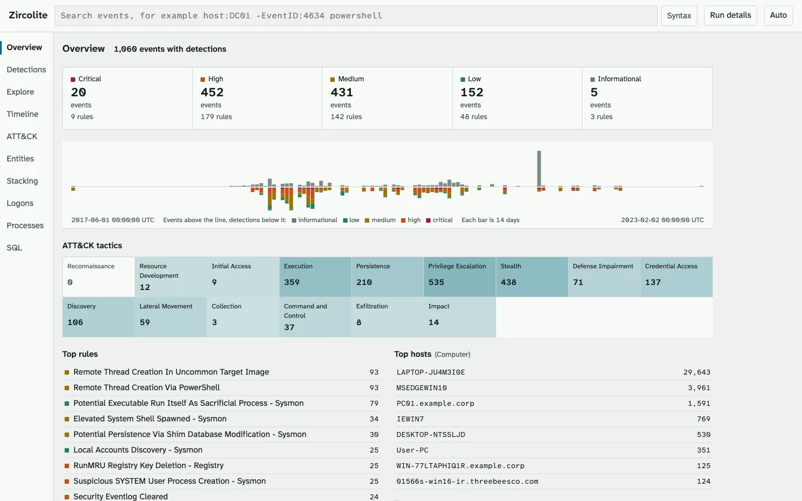
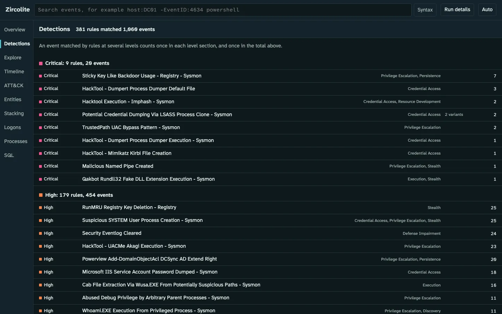
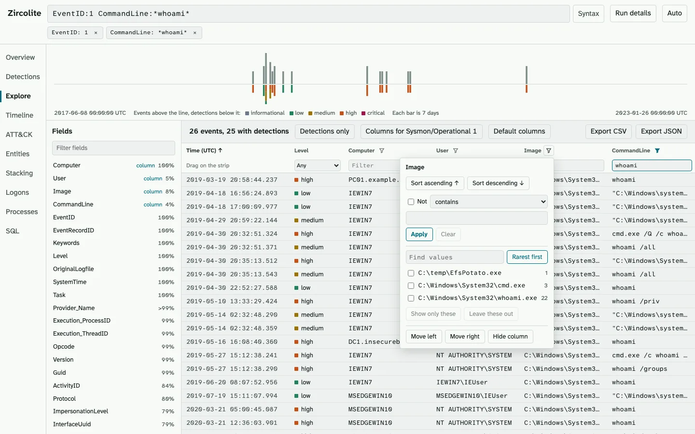
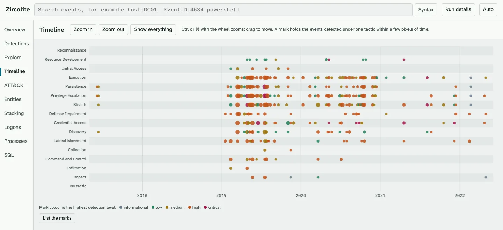
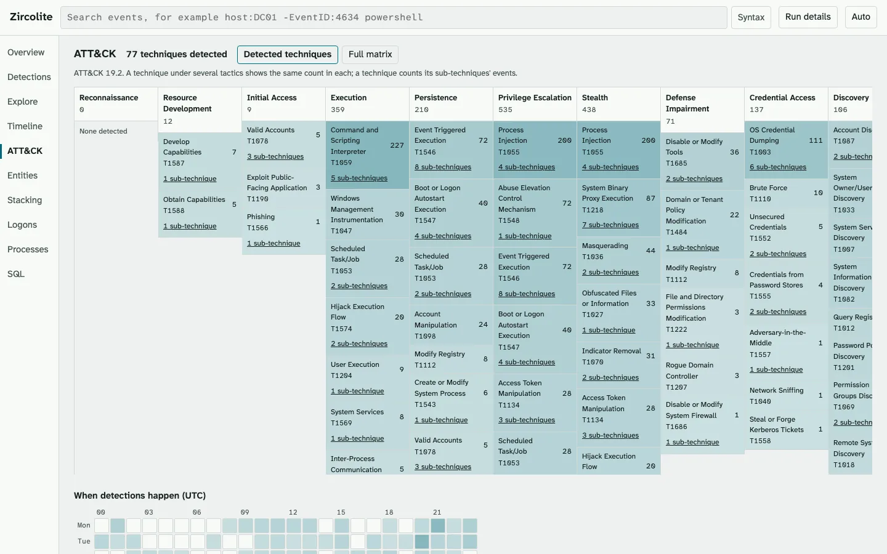
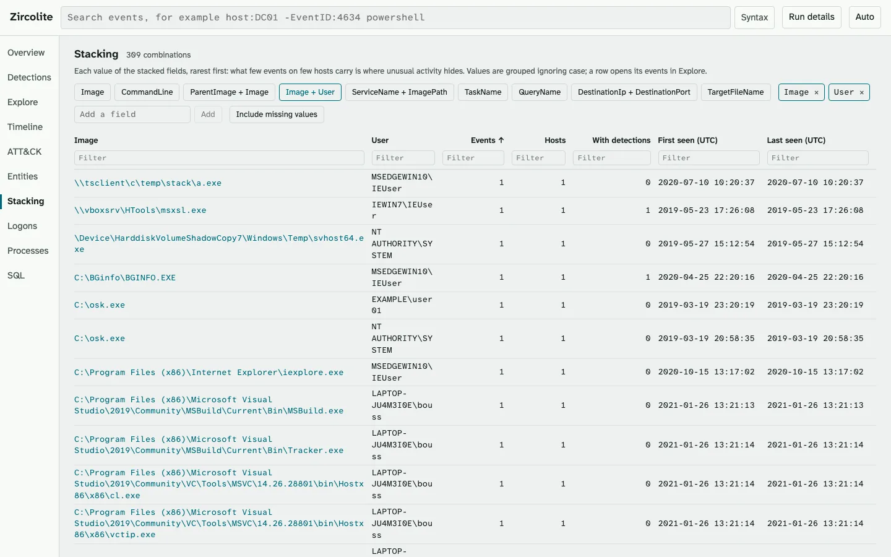
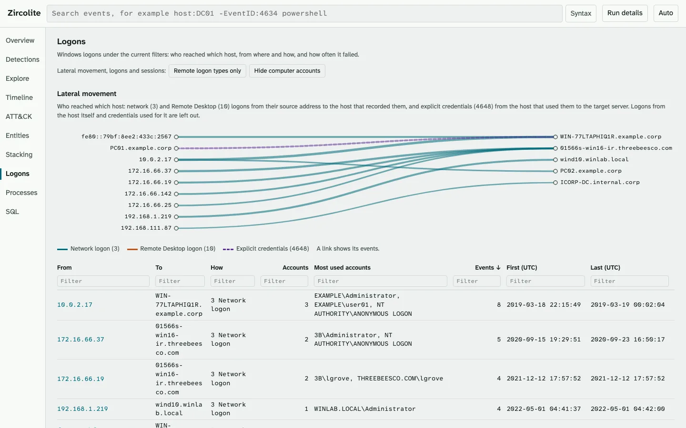
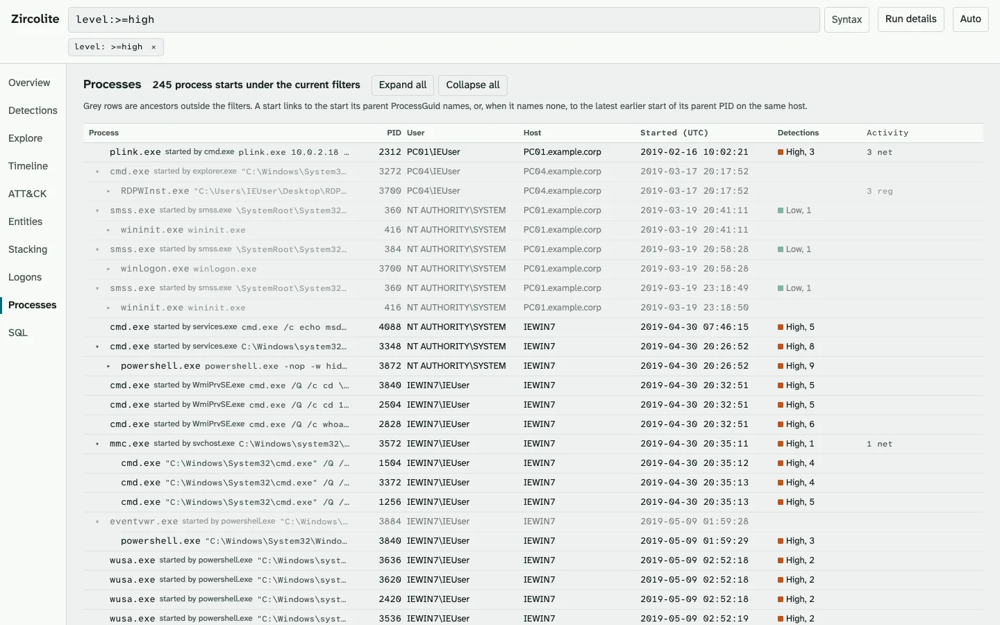

# Zircolite Viewer

`--package` writes one zip holding **every event** of a run, not only the matched ones,
together with the detections, the correlation alerts and a summary of the run. Extract it
and open `index.html`: the Zircolite Viewer runs in the browser, offline, with nothing to
install and no network request (its content security policy forbids them). Whoever receives
the zip can search the events and move between detections, hosts, accounts and processes.

The viewer is tested in current Chromium, Firefox and WebKit. On large packages, Chromium
browsers and Safari answer faster than Firefox.



## Making a package

```shell
python3 zircolite.py --events logs/ --package
python3 zircolite.py --events logs/ --package --package-dir /cases/host1
```

`--package` (`-G`) writes `zircolite-package-<RAND>.zip` to the working directory, or to
`--package-dir`, which must exist. In a [run configuration](Usage.md#yaml-configuration)
the keys are `output.package` and `output.package_dir`.

`--package-explore-index` (it implies `--package`; YAML `output.package_explore_index`)
adds a chronological index of event ids, times, hosts, channels and EventIDs. Explore uses it
in time order, with no column sort, when every search term is one the index covers. On the
1.87-million-event T001 capture it made paging through all events about 3.5 times faster and
host, channel or EventID pivots up to 2 times faster, for 4.6% more zip.

- **Every event is kept.** The [event filter](Advanced.md#early-event-filtering) is off for
  the run. The time and file filters still apply: use them to make a smaller package.
- **It is written even when no rule matched**, beside the usual detections output.
- **Problems surface before the run.** The destination, the viewer files and duckdb's
  built-in JSON and Parquet support are checked before any log is read, and a failed check
  stops the run there. duckdb is never allowed to download anything, and extensions other
  DuckDB programs installed in `~/.duckdb/extensions` are neither needed nor used.
- **A package is whole or absent.** It is assembled in a `tmp-zircolite-package-*`
  directory inside the destination, which needs room for the event spool, the Parquet files
  and the zip ([how much](Internals.md#stage-1-the-spool)), and moved into place when
  complete. If building it fails, Zircolite exits `1` once the detections are written.
- **The command line is not recorded**, so an archive password cannot leak into it. The
  package keeps the settings that shape what it shows: processing mode, time field, time
  bounds, `--limit`, number of rules.

Repeated exports reuse a verified cache of the viewer's own files, never of event data
([cache variables](Usage.md#performance)).

### Size limits

The browser holds the data in WebAssembly memory, which stops at 4 GB.

| Over 1 GiB as Parquet | Result |
|-----------------------|--------|
| The events | The package is refused. Narrow the run with `--after`/`--before` or `-s` |
| The full-text index | Left out, with a warning: bare-word searches scan every field, more slowly |
| The Explore index | Left out, with a note |

### Who should see a package

> [!WARNING]
> A package holds everything the logs recorded: account and host names, command lines, IP
> addresses, file paths. Share and store it as you would the logs themselves. The
> `README.txt` inside says the same.

## Opening a package

1. Extract the whole zip.
2. Open `index.html` from the extracted folder; double-clicking usually works.

The page cannot run from inside the zip, because it loads the files beside it. While it
loads, it lists its steps, with how much of the data has arrived and how long a slow step has
taken. It checks that every file arrived whole and that the engine holds exactly the events
and matches the package lists. A truncated package is reported, never shown incomplete.
These checks compare counts and sizes, not checksums.

All times are UTC; `--timezone` applies to the [`--timeline` file](Usage.md#timeline), not
to the Viewer.

**Filters.** The search box, the time range and **Detections only** (events at least one
rule matched) apply to every view, unless a view says otherwise. Each active filter shows as
a chip with an ×. The filters, the view, the table columns and the open event live in the
page's address, so **Back** steps through an investigation and a bookmark reopens it.

**Top bar.** **Syntax** opens the search help, **Run details** the run summary and its
warnings (a `--limit`, narrowed time bounds, inputs read in part, a missing full-text
index…), and the theme switch offers Auto, Light and Dark.

**While the page works.** A slow query shows a bar under the top bar, and the foot of the view
says what is running and for how long. The bar fills when progress is known (the full-text
index, a search of every field or of a large field) and sweeps otherwise. **Stop** cancels
every query; **Run again** restarts them.

**Keys.** `/` focuses the search, `?` opens the help, `Esc` closes what is on top, `j` and
`k` move through events in Explore, and `Enter` opens one.

**The event drawer.** Clicking an event anywhere opens it in a drawer: the rules that
matched it (each with **Filter by this rule**), then its fields grouped as System, User,
Process, Network, File and registry, and Other. Each value has + (filter for it), −
(filter it out) and **Copy**. **Show JSON** and **Copy JSON** give the whole event, and
**Events on _host_ within 5 minutes** shows what happened around it.

A value holding encoded text gets a **Decode** button. It decodes PowerShell encoded commands
(`-enc` and the other `-EncodedCommand` prefixes, only when they decode to UTF-16 text),
Base64 including gzip- or deflate-packed payloads, URL escapes and hex, two levels deep.
Results show as plain text, only when they read as text, first 64 KiB. A payload that breaks
off shows what it unpacked, marked **cut short**.

> [!NOTE]
> Logs come from the attacker's host, so decoding is bounded per value: 16 decodings, 4 MiB
> unpacked, the first 512 KiB searched. A decoding that hits a limit says which.

**Show in all events** clears the search, the time range and **Detections only**, returns to
time order, and scrolls the events table to the event, centred. It shows what happened just
before and after the event, whatever filter found it; Back restores the filters.

## The views

### Overview

Tiles for each severity level (and an **Unknown level** tile when some rules carry no Sigma
level), a histogram of events and detections over time, the ATT&CK tactics with detections,
the top rules, hosts and users, and the run's warnings. Every tile, cell and entry opens
Explore filtered to it. Drag across the histogram, or use the arrow keys with Shift and
`Enter`, to set the time range; `Esc` clears it.

### Detections



The rules that matched, grouped by level from critical down, with the events each matched
under the current filters. Entries of one rule (one Sigma id, or one title when there is
none) form one row at their highest level. A row opens to show the description, false
positives, techniques, tags and ruleset entries; **Show events** opens them in Explore,
**Add to search** adds the rule to the search.

A correlation rule also lists its alerts for the whole package (the first 200), each with
its group keys, metric and evidence events.

### Explore

Every event that matches the filters, in a table sorted by time. The **Fields** panel lists
every field with its coverage; open one for its ten most frequent values, each with + and −,
or show it as a column. **Export CSV** writes the shown columns, in the order shown, for up to
500,000 events, defusing spreadsheet formulas; **Export JSON** writes every field for up to
100,000 events, one object per line.



**Column filters.** Under each column name is a filter cell; type, then press `Enter`:

| In a cell | Keeps events whose value |
|-----------|--------------------------|
| `powershell`, `net user` | contains the text, in any case |
| `4624` | is exactly the number, in every column |
| `=cmd.exe` | is exactly the text, in any case |
| `C:\Windows\*`, `*\cmd.exe`, `a*b` | matches the wildcards |
| `"a*b"` | contains the text as written, `*` included |
| `>4600`, `>=1 <10` | compares as a number (numeric columns) |
| `*` / `!*` | has a value / has none |
| `!x`, `!=x`, `!>5` | does not match; events without the field stay in |

A whole number is an exact match even in a column the package stores as text, as it stores
`EventID` when its sources mixed numbers and text; `*4624*` finds the digits anywhere. `!` leaves
matches out because `-` starts values analysts look for, such as `-enc`. `Esc` puts back what the cell held; an empty cell
removes the column's filter.

The funnel beside a column name opens its menu, which has:

- the sort, both ways;
- a form with the operators for the column's type: contains, equals, starts with, ends with,
  matches a pattern, has a value or none for text; =, >, ≥, <, ≤ or between for numbers;
- **Not**, **Apply** and **Clear**;
- the column's values. They are counted under every filter except the column's own, so several
  can be ticked, then kept with **Show only these** or dropped with **Leave these out**. **Rarest
  first** lists the least frequent values first, where unusual activity tends to be.

The Level column's cell picks a level and up.

Every column filter is ordinary search text (`CommandLine:*"net user"*`,
`(Channel:Security OR Channel:System)`), so it shows in the search box and as a chip. It is
kept in the link, Back undoes it, and every view applies it. A column whose terms no single
filter describes, such as two contains, shows them read-only; edit them in the search bar, or
clear them from the cell.

**Sorting and columns.** Click a column's name to sort, again to reverse, and **Time (UTC)**
to return to time order; ties stay in time order, and text sorts by its first 128 characters,
ignoring case. Drag a name to move the column (or **Move left**/**Move right**), drag a header
edge to resize it (arrow keys on a focused edge, `Delete` or a double click to reset). The
order, widths and sort are kept in the link.

When the results hold one kind of event, such as Security 4624 or Sysmon 1, **Columns for…**
shows the fields that tell those events apart, the host first. The search's own EventID and
Channel name the kind; otherwise the viewer looks when the results hold up to 200,000 events.
**Default columns** goes back.

### Timeline



Detections over time, one lane per ATT&CK tactic in attack order, plus one for rules
without a tactic. Each mark is coloured by its highest level. `Ctrl`/`⌘` + wheel zooms and
dragging pans; the arrow keys, `+`, `-` and `0` do the same. The visible window becomes the
page's time range. Clicking a mark opens its earliest event; **Show these _N_ in Explore**
lists them all.

### ATT&CK



The ATT&CK matrix, shaded by events with detections: **Detected techniques** or the **Full
matrix**. Sub-techniques open beneath their technique. Tags the bundled catalogue does not
list as active are shown apart, never dropped: **revoked** (with the replacement),
**retired**, or **unknown**. A weekday-by-hour heatmap shows when detections happen.

### Entities

Hosts, users, IP addresses, processes, hashes and domains among the filtered events, with
their event counts, detection counts and first and last times. Values are grouped ignoring
case; up to 500 rows show, busiest first. Each column sorts on a click and has a filter cell
with the [column filter](#explore) syntax, such as `>=10` under Events or `admin` under Users.
Times are typed in UTC: `>=2021-06-03` or `<2021-06-03 08:00`. These filters narrow the table
only, never the search, and the count above the table counts what they keep.

| Kind | Fields |
|------|--------|
| Hosts | `Computer`, `ComputerName`, `Hostname`, `host` |
| Users | `TargetUserName`, `SubjectUserName`, `User`, `UserName`, `AccountName` |
| IP addresses | `SourceIp`, `DestinationIp`, `IpAddress`, `SourceAddress`, `DestAddress`, `ClientAddress` |
| Processes | `Image`, `NewProcessName`, `ParentImage`, `ProcessName` |
| Hashes | `SHA256`, `SHA1`, `MD5`, `IMPHASH` |
| Domains | `QueryName`, `DestinationHostname` |

### Stacking



Least-frequency analysis: each value of one to three fields among the filtered events, rarest
first, with its events, hosts, events with detections, and first and last times. What few
events on few hosts carry is where unusual activity tends to be. Presets are offered when the
package has their fields: `Image`, `CommandLine`, `ParentImage + Image`, `Image + User`,
`ServiceName + ImagePath`, `TaskName`, `QueryName`, `DestinationIp + DestinationPort` and
`TargetFilename`, with Security 4688's `NewProcessName`, `ParentProcessName`,
`TargetUserName` or `SubjectUserName` standing in for Sysmon's names. **Add a field** stacks any other. Values are grouped ignoring case. Events
without a stacked field are left out unless **Include missing values** is on, which lists them
as `(missing)`. Each column sorts and filters like [Entities](#entities). A row opens exactly its
events in Explore. Up to 1,000 rows show.

### Logons



Windows logons under the current filters, for following an account across hosts. Each table
sorts and filters like [Entities](#entities), and a row opens exactly its events in Explore.

| Table | Built from |
|-------|-----------|
| **Lateral movement** | Who reached which host: a source address to the host that recorded a network (3) or Remote Desktop (10) logon (4624), or a host that used explicit credentials (4648) to the target server. Local logons are left out. The graph draws the first 60 links, wider for more events |
| **Logons and failures** | 4624 and 4625 by host, account, logon type and source, failures first, with named logon types and failure reasons (`SubStatus`, or `Status`) |
| **Explicit credentials** | 4648: a process on one host using another account's credentials, with the target server |
| **Sessions** | Each logon with its logoff (4634, 4647) on the same host and logon ID, and its length. A session's host opens its activity: the events carrying its logon ID until logoff |
| **Remote Desktop** | RemoteConnectionManager 1149, LocalSessionManager 21, 22, 24, 25, and Security 4778, 4779, one row per kind |

- **Special privileges** shows what 4672 granted a session (`SeDebugPrivilege` marks an
  administrator logon). A 4672 counts when it is on the same host and logon ID, at most
  5 s before the logon or 2 s after it. Filter the column with `*` for privileged sessions.
- **Remote logon types only** keeps types 3 and 10; **Hide computer accounts** drops names
  ending in `$`. Both are off by default.
- Tables and columns whose fields the package lacks say so, or are left out.

### Processes



Process starts as a tree — Sysmon event 1 (Windows or Linux) and Security event 4688 —
with image, command line, PID, user, host, start time and highest detection. The first
20,000 matching starts show; their ancestors are added in grey for context, so a search for
`whoami.exe` still shows the shell that started it.

A start links to its parent by `ParentProcessGuid` when it names one. Otherwise the parent
is the latest earlier start of the parent PID on the same host (`ParentProcessId` in Sysmon,
`ProcessId` in event 4688). Links are made across every start in the package, so a filter
never changes who started what.

The **Activity** column counts what Sysmon recorded under each `ProcessGuid` across the
package: network connections (3), DNS queries (22), files created (11) and registry changes
(12–14). A selected process gets one button per kind, opening exactly those events in
Explore; the event drawer shows the same counts under **Process activity**.

### SQL

A console for one query at a time over the package's tables; see
[The SQL console](#the-sql-console).

## Search grammar

| Search | Meaning |
|--------|---------|
| `powershell` | Any field contains the word, in any case |
| `"net user"` | Any field contains the phrase |
| `EventID:4624` | A field equals a value, in any case |
| `Image:*\cmd.exe` | `*` matches any characters, outside quotes |
| `CommandLine:*"net user"*` | A `*` right beside the quotes matches any characters there, so a field can contain a phrase |
| `EventID:>4600` | Numeric fields compare with `>`, `>=`, `<` and `<=` |
| `-Channel:Security` | Leave matches out; events without the field stay in |
| `a OR b` | Either term. Terms side by side must both match |
| `(a OR b) c` | Parentheses group terms |
| `"level":error` | Quote a field name that clashes with a shortcut |

| Shortcut | Example | Matches |
|----------|---------|---------|
| `rule:` | `rule:*powershell*` | Events a rule matched, by title or id |
| `rulekey:` | `rulekey:"Encoded PowerShell"` | Events of one rule as Detections groups it |
| `level:` | `level:>=high` | Events by highest detection level; `level:<informational` for rules without one |
| `tactic:` | `tactic:persistence` | Events detected under an ATT&CK tactic |
| `technique:` | `technique:T1059` | Events detected under a technique, sub-techniques included |
| `weekday:` | `weekday:sat` | Events on a weekday (UTC): `mon`, `monday`, or `1` to `7` |
| `hour:` | `hour:>=22` | Events in an hour of the day (UTC), 0 to 23 |
| `host:` | `host:DC01` | Events from a host, whichever host field holds it |
| `user:` | `user:administrator` | Events naming an account, whichever user field holds it |
| `uids:` | `uids:4294967297,4294967301` | Events by their ids in the package (`_zl_uid`), up to 1,000, as the SQL console opens them |

- Field names ignore case; an unknown one is refused with the nearest names. Values may
  hold colons, so paths, times and IPv6 addresses need no quotes.
- Inside quotes, `\"` is a quote and `\\` a backslash; other backslashes stay as typed, so
  Windows paths work. `*` is a wildcard only outside quotes, so `Field:*"x"*` contains `x`;
  to find quote marks, escape them inside the quotes: `Field:*"\"x\""*`.
- The first bare-word search loads the packaged full-text index and shows its progress.
  Later searches reuse it. When the package omits the index, bare words scan every
  column. A field search such as `CommandLine:*mimikatz*` reads just that field.
- A search that does not parse is not applied, and the bar says where it fails. One that
  arrives through a link and does not parse matches nothing, never everything.

## The SQL console

The SQL view runs one query at a time over these tables:

| Table | One row per | Columns |
|-------|-------------|---------|
| `events` | event | `_zl_uid` (the event's id), `_zl_part`, `_zl_time` (UTC timestamp, NULL when unreadable), `_zl_spelling`, then every field of the run |
| `rules` | ruleset entry that matched | `rule_idx`, `key`, `id`, `title`, `level`, `level_rank`, `description`, `falsepositives`, `tags`, `tactics`, `techniques`, `sigmafile`, `result_type`, `count`, `linked`, `unlinked`, `alert_count`, `event_count` |
| `hits` | rule and event it matched | `rule_idx`, `_zl_uid` |
| `alerts` | correlation alert | `alert_idx`, `rule_idx`, `_zl_part`, `alert_id`, `group_keys`, `occurrence_time`, `window_start`, `window_end`, `metric_name`, `metric_value`, `event_count`, `child_alert_ids` |
| `alert_events` | evidence event of an alert | `alert_idx`, `_zl_uid`, `ord` |
| `explore` | event, in time order; only with `--package-explore-index` | `_zl_pos`, `_zl_uid`, `_zl_time`, the host, channel and EventID fields |

```sql
-- Hosts by events with detections
SELECT Computer, count(*) AS events, count(h._zl_uid) AS detected
FROM events e LEFT JOIN (SELECT DISTINCT _zl_uid FROM hits) h USING (_zl_uid)
GROUP BY Computer ORDER BY detected DESC

-- The events of PowerShell rules, earliest first
SELECT e._zl_time, r.title, e.Computer, e.CommandLine
FROM hits h JOIN rules r USING (rule_idx) JOIN events e USING (_zl_uid)
WHERE r.title ILIKE '%powershell%'
ORDER BY e._zl_time
```

- One `SELECT` at a time (with `WITH`, `VALUES` and FROM-first forms), or `DESCRIBE` or
  `SHOW`. Anything else — a second statement, `CREATE`, `INSERT`, `ATTACH`, `COPY`, `SET`,
  `PRAGMA` — is refused, and the package's tables cannot change.
- Values come back as text, so 64-bit integers stay exact. At most 10,000 rows show;
  **Export CSV** saves them.
- A result with a `_zl_uid` column opens its events. Each id is a link to its event, and
  **Open in Explore** lists the result's events with a `uids:` search. It opens up to 1,000 events,
  and only when every row of the result is shown.
- Each result column sorts on a click and has a filter cell with the [column filter](#explore)
  syntax: numbers compare as numbers, everything else as the text shown. Filters and sorts
  run in the engine over every row of the query, not only the 10,000 shown, and a new query
  starts without them.
- The page's filters do not apply here: write them in SQL. `Ctrl`/`⌘` + `Enter` runs the
  query, and **Tables** lists every column.

## For developers

- The sources are in `gui/source/` (Svelte, TypeScript and Vite over DuckDB-WASM). The build
  in `gui/viewer/` is committed and copied into every package. `task gui-build` runs `npm ci`,
  `npm run check`, `npm test` and `npm run build`; commit `gui/viewer/` with any source
  change. CI fails when a rebuild differs from it by a single byte.
- The scripts in `gui/source/e2e/` drive an extracted package from `file://`:
  `npm run smoke -- <dir>` (opens it in Chromium, Firefox and WebKit), `npm run e2e -- <dir>`
  and `npm run views -- <dir>` (cross-check Explore and every view), `npm run perf -- <dir>`
  and `npm run shot -- <dir> <out.png>`. They need `npx playwright install chromium firefox webkit`.
  `smoke`, `e2e` and `views` drive the three browsers at the same time:
  `ZL_BROWSERS=chromium,webkit` picks fewer, and `ZL_BROWSER_JOBS=1` runs them one after another.
- `npm run wasm-pivots -- <dir> [--full]` checks and times an Explore-index package in
  Node's DuckDB-WASM, without a browser.
- The ATT&CK catalogue is MITRE ATT&CK Enterprise 19.2; MITRE's notice travels in every
  package as `THIRD_PARTY_NOTICES.txt`. To update it, run
  `node scripts/attack-catalog.mjs enterprise-attack-X.Y.json` in `gui/source/`, refresh
  `scripts/attack-terms.txt` from MITRE's
  [terms of use](https://attack.mitre.org/resources/legal-and-branding/terms-of-use/), then
  rebuild and commit.
- [Internals → Package pipeline](Internals.md#package-pipeline) describes how a package is
  written and read.
